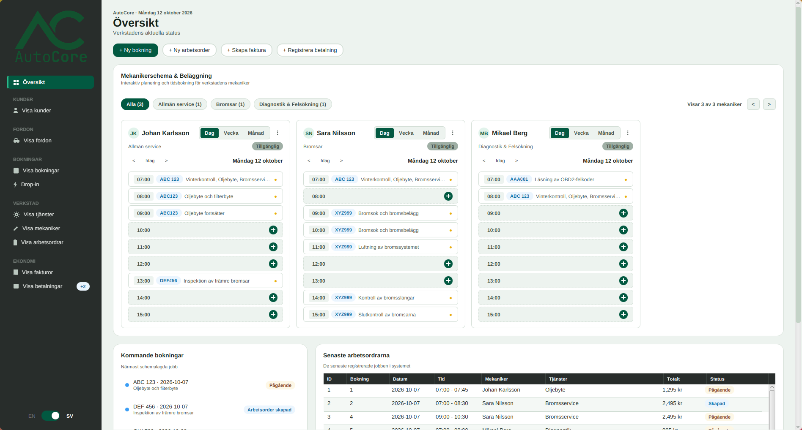
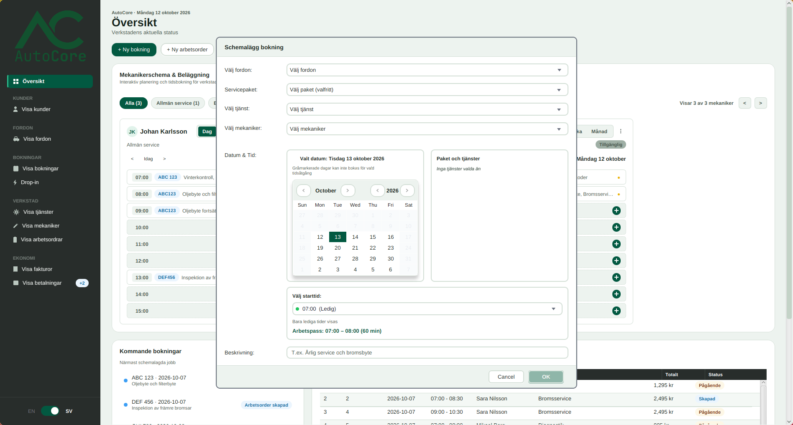
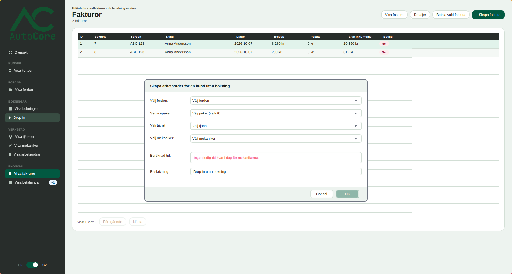
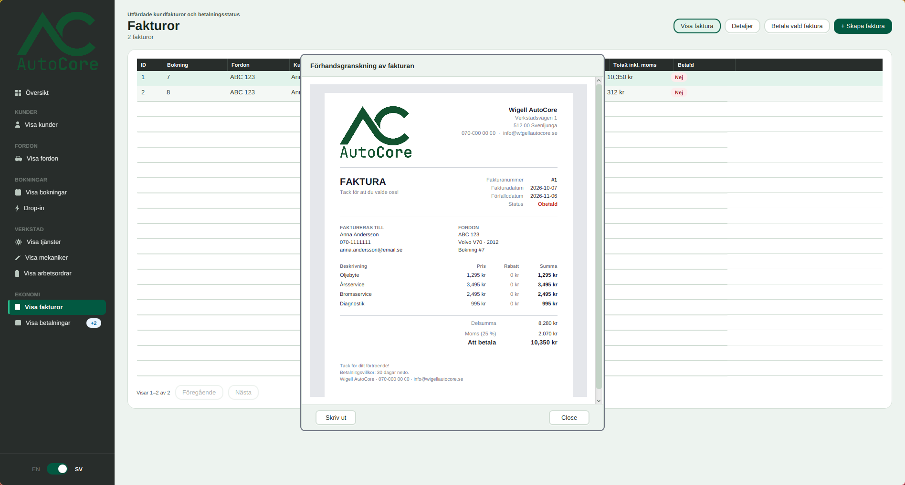

# AutoCore

Ett verkstadssystem för bilverkstäder. Kunder, fordon, bokningar, arbetsordrar, fakturor och betalningar, med ett skrivbordsgränssnitt i JavaFX och en lokal SQLite-databas som följer med mellan körningar.



Siffrorna i menyn visar vad som väntar på hantering.

## Funktioner

- Kunder och fordon, med ägarkoppling.
- Bokningar med en eller flera tjänster, tidsberäkning och skydd mot överlapp.
- Servicepaket, färdiga buntar av tjänster att utgå från i en bokning.
- Mekaniker med specialisering, schema och belastning.
- Tjänstekatalog med pris och beräknad tid.
- Arbetsordrar i tre typer: standard, reklamation och internt arbete.
- Utkast som fylls på efter hand, och drop-in utan bokning.
- Statusflöde från skapad till klar, med spärrar mot orimliga byten.
- Inloggning med tre roller, och en behörighetsspärr i kärnan som gäller både läsning och skrivning.
- Loggning med trace-id per operation, så en nekad åtkomst och raden som förklarar den hör ihop.
- Fakturor med flera rader, rabatt och moms.
- Betalning via kort, Swish eller kontant.

## Kom igång

Du behöver JDK 25 och Maven 3.9 eller senare. Bygget kräver exakt JDK 25, och `pom.xml` stannar med ett läsbart meddelande om du kör en annan version. JavaFX, sqlite-jdbc och json hämtas av Maven.

```
mvn -f WigellAutoCore/autocore/pom.xml package
```

Starta applikationen:

```
./start.sh
```

Databasen skapas vid första starten i `data/autocore.db` i projektroten, med demodata om filen inte finns sedan tidigare.

Jar-filen startar utan extra flaggor, eftersom manifestet redan innehåller `Enable-Native-Access: ALL-UNNAMED`:

```
java -jar WigellAutoCore/autocore/target/autocore-4.0.0.jar
```

Öppnar du projektet i en IDE, importera `WigellAutoCore/autocore/pom.xml` som ett Maven-projekt. Modulfilerna delas inte via git eftersom de pekar på den plattform din maskin råkar ha, och Maven väljer rätt JavaFX för Linux, Windows och macOS.

### Får du "No suitable driver found for jdbc:sqlite"?

Kör `mvn -f WigellAutoCore/autocore/pom.xml dependency:resolve` så hämtar Maven filerna igen.

## Konfiguration

Allt som ändras mellan installationer är inställningar och inte kod.

**Databasen.** Sökvägen står som `autocore.db.path` i `src/main/resources/application.properties` och kan skrivas över vid körning:

```
mvn -f WigellAutoCore/autocore/pom.xml spring-boot:run \
    -Dspring-boot.run.arguments=--autocore.db.path=/tmp/kopia.db
```

Spring bygger `Db` med den sökvägen, och varje repository får sin `Db` via `RepositoryFactory` i stället för att läsa en statisk sökväg. Ett program som körs utan Spring läser samma property med `-Dautocore.db.path=...`, eller tar filen som första argument.

**Loggen.** Filen hamnar i `logs/autocore.log`. Katalogen flyttas med `AUTOCORE_LOG_DIR`. Filen rullar vid 10 MB, sparas i fjorton dagar och har ett tak på 200 MB.

**Lösenorden.** Inga hemligheter ligger i git. Demokontona skapas av migrering 004 och kolumnen `password_hash` innehåller en hash som inte går att räkna baklänges. Vill du sätta egna lösenord läses de från miljön:

```
AUTOCORE_ADMIN_PASSWORD=... \
AUTOCORE_STAFF_PASSWORD=... \
AUTOCORE_READONLY_PASSWORD=... \
./start.sh
```

Värdet hashas vid start med nytt salt och skrivs över bara om det skiljer sig från det som redan står i tabellen. Ett för kort lösenord stoppar starten med kontots namn, aldrig med värdet. `SecretScanTest` läser alla filer git spårar och faller om ett lösenord, en nyckel eller en token skrivs in.

## Inloggning och roller

Applikationen börjar med en inloggning. Fönstret visar ett inloggningskort, konsolversionen frågar i terminalen, och det fristående programmet sätter en identitet själv. Alla tre går genom samma `GuardedGarageSystem`.

Kontona ligger i tabellen `users`, som migrering `004_users.sql` skapar.

| Konto | Roll | Får | Får inte |
|---|---|---|---|
| `admin` | `ADMIN` | allt, alla 30 operationer | inget |
| `staff` | `STAFF` | kunder, fordon, bokningar, arbetsorder, tjänster och mekaniker, och att välja språk | radera kund, fordon, mekaniker eller arbetsorder; ändra inställningar; hela ekonomin |
| `readonly` | `READ_ONLY` | `READ` och `CHANGE_LANGUAGE` | allt som ändrar något, och ekonomin |

Lösenordet ligger som en PBKDF2-hash med salt, aldrig i klartext. Migreringen skrev 210 000 varv, och en rad som är svagare än 600 000 smälts om vid nästa lyckade inloggning. `LoginService` svarar lika för "ingen sådan användare" och "fel lösenord", så gränssnittet inte berättar vilka namn som finns.

Vem som är inloggad hålls av `IdentityHolder` i kärnan. Den fylls vid inloggning, töms vid utloggning, och är vanlig Java utan Spring, så konsolen och det fristående programmet har egna.

Vad rollen får göra är data, inte villkor utspridda i koden. `RoleMatrix` har en rad per roll, och `Operation` namnger varje sorts arbete. En roll eller operation som saknas ger nej, aldrig ja. Administratören definieras som alla operationer, så en ny operation är dess till dess att någon uttryckligen tar bort den från personalen.

Kontrollen sitter i spärren, inte i fönstret. `GuardedGarageSystem` ligger framför `GarageSystem` och kräver en operation för varje anrop, både när något läses och när något skrivs. Den skiljer på två nej: ingen inloggad (`NotAuthenticatedException`) och rollen får inte (`AccessDeniedException`).

Fönstret frågar samma objekt innan det ritar, genom `GarageSystem.may(Operation)`. `Actions` gömmer en kontroll rollen inte får använda och tar bort dess plats i layouten, och kontrollen får ett filter som konsumerar händelsen om någon ändå når den. Att dölja är artigheten. Spärren är regeln, och den ligger kvar under båda lagren. `NoUnguardedConstructionTest` fäller en klass som skapar `new GarageSystem(` i stället för att gå genom spärren.

Skälen bakom de valen står i [docs/arkitekturbeslut.md](docs/arkitekturbeslut.md).

## Loggning

Loggningen går genom SLF4J och Logback. `logback-spring.xml` har två profiler. Utan profil, eller i `dev`, loggas applikationens egen kod på DEBUG till både konsol och fil. I `prod` loggas den på INFO, allt annat på WARN, och bara till fil.

Varje rad bär tidpunkt, nivå, tråd, `trace`, `op` och logger:

```
2026-10-22T14:45:18.391+02:00 INFO  [main] [trace=87daa17e op=CREATE_WORK_ORDER] c.w.a.service.WorkOrderService - Arbetsorder 7 skapad för bokning 7
```

`trace` är ett trace-id som sätts när en operation börjar, och `op` är operationens namn ur `Operation`. Båda ligger i MDC, så varje rad som skrivs under anropet får dem utan att loggningen behöver skicka med dem. En läsning som görs inuti en ändring ansluter till det pågående trace-id:t i stället för att starta ett nytt.

Det som loggas är verksamhetshändelser, som att en arbetsorder skapas och slutförs, och säkerhetshändelser, som en nekad åtkomst med användare, roll och operation, men aldrig med det användaren skrev. Ett tekniskt fel loggas med undantaget och sin stapl. Användaren får en mening utan klassnamn och utan intern text.

Konsolversionen och det fristående programmet har ingen Spring-kontext och läser därför `logback-standalone.xml`, med samma mönster och samma fil.

Tre prov håller loggningen på plats. `LogContentTest` läser den fil provet själv skriver och letar trace-id, hemligheter och personuppgifter. `EventLoggingTest` fångar raderna i minnet och prövar händelserna och användartexten. `SecretScanTest` läser källkoden.

## Arkitektur

```
WigellAutoCore/autocore/
├── pom.xml
└── src/
    ├── main/java/com/wac/autocore/
    │   ├── AutoCoreApplication.java  Springs ingång
    │   ├── Main.java                 startar fönstret
    │   ├── ConsoleApp.java           konsolversionen
    │   ├── config/         Db som böna, sökvägen som property,
    │   │                   identiteten och inloggningen som bönor
    │   ├── data/           databasen, migreringarna och demodata
    │   ├── exception/      undantagen, med nyckel för texten
    │   ├── model/          domänmodeller
    │   ├── repository/     läsning och skrivning mot SQLite
    │   ├── security/       identiteten, rollerna, operationerna och lösenordshashen
    │   ├── seed/           demodatans texter, svenska och engelska
    │   ├── service/        affärslogik, GarageSystem som fasad,
    │   │                   GuardedGarageSystem som spärr,
    │   │                   Printer för utskrifter,
    │   │                   gateway/ för arbetsorderns ingång
    │   ├── standalone/     det fristående programmet
    │   ├── theme/          teman och stilmallar
    │   ├── util/           resursläsning och texterna
    │   └── ui/             gränssnittet: dialoger, vyer, komponenter,
    │                       i18n, motion, navigation och teman
    ├── main/resources/
    │   ├── com/wac/autocore/db/migrations/  de fyra SQL-filerna
    │   ├── com/wac/autocore/i18n/           sv.json och en.json
    │   ├── com/wac/autocore/theme/themes/   stilmallarna
    │   ├── com/wac/autocore/images/         bilderna
    │   ├── application.properties
    │   ├── logback-spring.xml
    │   └── logback-standalone.xml
    └── test/java/com/wac/autocore/
        └── ...             JUnit-proven
```

Resurserna, alltså SQL, JSON, CSS och bilderna, ligger under `src/main/resources` och följer med i jar-filen.

Lagren går i en riktning. Gränssnittet pratar med `GarageSystem`, som pratar med serviceklasserna, som pratar med repositoryt. Ingen genväg förbi. Arbetsordern går genom `WorkOrderGateway`, som är ett smalare gränssnitt mot samma tjänster.

### Bokning och arbetsorder

En bokning registreras som `BOOKED` och skapar ingen arbetsorder. Arbetsordern skapas först när fordonet lämnas in, från Kanban-vyn eller arbetsorderdialogen.

Bokningsdialogen visar lediga och upptagna timmar per mekaniker. Tjänsternas tider summeras, så en bokning som sträcker sig över flera timmar kan inte läggas ovanpå en annan. Avbokar du en bokning frigörs tiderna direkt.



Kalendern stryker de dagar och tider som inte går att boka.

Ett servicepaket är en färdig bunt av tjänster. Väljer man ett paket i bokningen hamnar paketets tjänster i bokningen som dess egna, och paketet kan ändras efteråt utan att bokningen rörs.

En arbetsorder har en typ: standard, reklamation eller internt arbete. Reklamationen utgår från en slutförd order och pekar tillbaka på den, och kunden betalar normalt ingenting. Är ordern inte färdig än kan den ligga som utkast med bara fordon och beskrivning, och fyllas på med tjänster, mekaniker och planerat datum efter hand. Drop-in skapas direkt, utan bokning.



Mekanikerns behörighet hänger på en nyckel. Tjänsten anger vilken specialisering den kräver, och en tjänst utan krav kan utföras av alla.

### Schemat

Översikten har en Kanban-tavla per mekaniker med dag, vecka och månad. Dagen visar tio timmar mellan 07:00 och 17:00, lediga timmar går att boka direkt, och ett klick på en bokad timme fäller ut detaljer om fordon, kund och arbetsorder. Veckovyn färgkodar belastningen i fyra steg.

### Fakturering

Fakturan bygger på de tjänster som markerats som utförda, och tar priset som gällde när arbetet gjordes. Rabatt och moms räknas per rad, och fakturan går att granska innan den skickas.



### Språk

Svenska och engelska byts med knappen i menyn, utan omstart. Datum, statusord och valutor följer språket.

## Fristående program och konsol

Båda kör samma tjänster som fönstret och går genom samma behörighetsspärr, så ingen av dem är en väg runt inloggningen. De startas utanför Maven och behöver därför veta att SQLite får använda inbyggd kod:

```
java --enable-native-access=ALL-UNNAMED -cp "WigellAutoCore/autocore/target/classes:$(cat WigellAutoCore/autocore/target/cp.txt)" com.wac.autocore.standalone.StandaloneWorkOrders /tmp/fristaende.db
```

Konsolversionen frågar efter användare och lösenord, och avslutas med felkod efter tre försök:

```
java -cp "WigellAutoCore/autocore/target/classes:$(cat WigellAutoCore/autocore/target/cp.txt)" com.wac.autocore.ConsoleApp data/autocore.db
```

## Tester

```
mvn -f WigellAutoCore/autocore/pom.xml test
```

140 JUnit-prov, och ingen av dem hoppas över. Loggprovningen skriver sin egen loggfil i stället för att läsa en som råkar finnas.

CI kör `package` i stället för `test` på varje push och varje pull request mot `develop` och `main`.

## Dokumentation

De arkitektoniska besluten står i [docs/arkitekturbeslut.md](docs/arkitekturbeslut.md), och resten av projektdokumentationen i [docs/README.md](docs/README.md).

## Utvecklat av

Alex, Lucas och Daniel.
