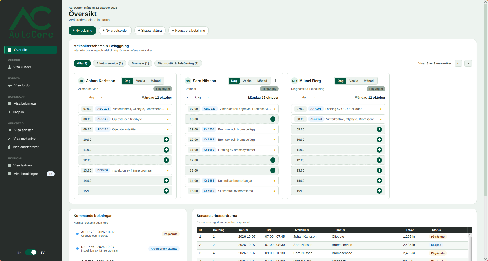
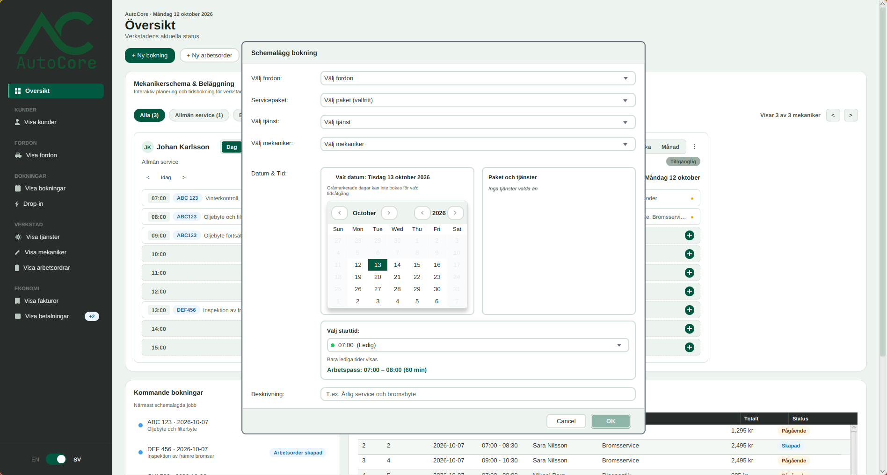
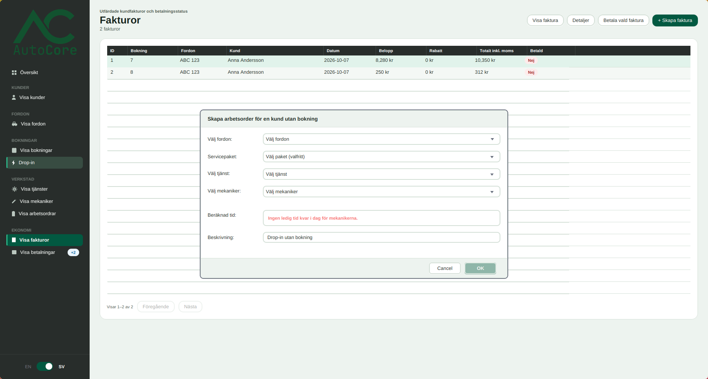
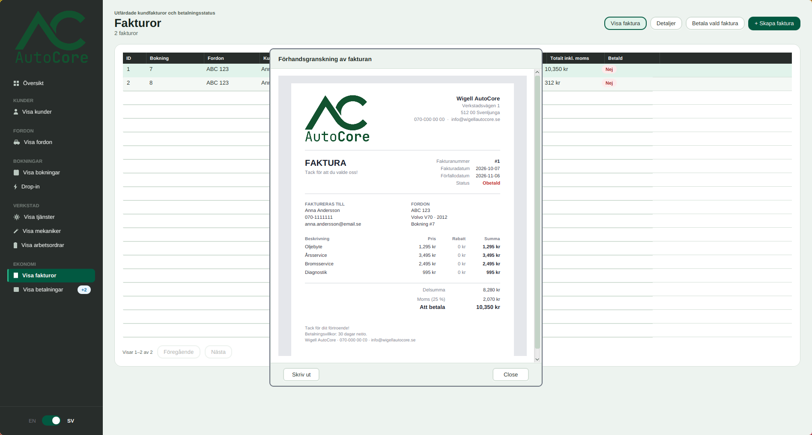

# AutoCore

Ett verkstadssystem för Wigell Group. Kunder, fordon, bokningar, arbetsordrar, fakturor och betalningar, med ett JavaFX-gränssnitt och SQLite lokalt.

Planen för migreringen till 4.0, med riskanalysen, ligger i [docs/plan-4.0.md](docs/plan-4.0.md).

Loggerna som demonstrationen kräver, med kommandona som ger dem, ligger i [docs/demo-loggning.md](docs/demo-loggning.md).

## Vad systemet gör

- Kunder och fordon, med ägarkoppling.
- Bokningar med en eller flera tjänster, tidsberäkning och skydd mot överlapp.
- Servicepaket: färdiga buntar av tjänster att utgå från i en bokning.
- Mekaniker med specialisering, schema och belastning.
- Tjänstekatalog med pris och beräknad tid.
- Arbetsordrar i tre typer: standard, reklamation och internt arbete.
- Utkast som fylls på efter hand, och drop-in utan bokning.
- Statusflöde från skapad till klar, med spärrar mot orimliga byten.
- Fakturor med flera rader, rabatt och moms.
- Betalning via kort, Swish eller kontant.



Siffrorna i menyn visar vad som väntar på hantering.

## Innan du bygger

JDK 25 och Maven 3.9 eller senare. Bygget kräver exakt JDK 25: `pom.xml` stannar med ett meddelande om du kör en annan version.

Skälet är JavaFX, inte Spring. `spring-boot-4.0.6.jar` och `spring-core-7.0.7.jar` är byggda för Java 17 (class file 61), men `javafx-base-25.0.4-linux.jar` är byggd för Java 23 (class file 67). Under 23 går bygget inte alls, och då svarar `pom.xml` med en läsbar rad i stället för ett fel om class file-versioner. Vi stannar på 25 eftersom det är den version projektet byggs och prövas på, både lokalt och i CI. WAC4_0 §2 säger "Java 17 eller senare", så kravet är uppfyllt; bygget begär bara mer än kravet gör.

```
mise use java@25
mvn -f WigellAutoCore/autocore/pom.xml package
```

JavaFX 25, sqlite-jdbc och json hämtas av Maven, så inget installeras för hand.

Öppna projektet i IntelliJ genom att högerklicka på `WigellAutoCore/autocore/pom.xml` och välja **Add as Maven Project**. Modulfilerna delas inte via git, eftersom de pekar på den plattform din maskin råkar ha. Maven väljer rätt JavaFX för Linux, Windows och macOS, så samma pull fungerar för alla.

## Bygg och kör

`./start.sh` kontrollerar att du har JDK 25 och Maven 3.9, sätter `GDK_BACKEND=x11` på Linux och kör sedan `mvn spring-boot:run` — samma bygge som IntelliJ gör. Starta appen med `./start.sh`, eller kör `Main.java` från IntelliJ.

### Får du "No suitable driver found for jdbc:sqlite"?

Drivrutinen ligger i `.idea/libraries/` och följer med i giten. Felet betyder att IntelliJ kör en gammal projektmodell: välj **File → Reload All from Disk**, eller stäng och öppna projektet. Går det inte, kör `mvn -f WigellAutoCore/autocore/pom.xml dependency:resolve` så att Maven hämtar filerna igen. `./start.sh` behöver inget av det.

Körningen behöver en bildskärm. På Wayland sätter `start.sh` `GDK_BACKEND=x11` själv, eftersom JavaFX annars kraschar i GTK.

### Skalan gränssnittet ritas i

JavaFX frågar GTK hur stort allt ska vara, och svaret kommer från `GDK_SCALE`. En session som startades innan skärmens skala sänktes behåller det gamla värdet, och då ritas varje knapp, varje typsnitt och hela fönstret dubbelt så stort. `Main` sätter därför `glass.gtk.uiScale` till 1 innan JavaFX startar, så ett ärvt värde inte når fönstret. Det gäller även när appen startas från IntelliJ, som aldrig går genom `start.sh`.

Behöver skärmen en annan skala går det att be om den:

```
AUTOCORE_UI_SCALE=2 ./start.sh
```

### Fristående program

Det fristående programmet startas utanför Maven, och då behöver JDK 25 veta att SQLite får använda inbyggd kod. Utan flaggan kommer `WARNING: Restricted methods will be blocked in a future release`:

```
java --enable-native-access=ALL-UNNAMED -cp "WigellAutoCore/autocore/target/classes:$(cat WigellAutoCore/autocore/target/cp.txt)" com.wac.autocore.standalone.StandaloneWorkOrders /tmp/fristaende.db
```

Jar-filen behöver ingen flagga. Raden `Enable-Native-Access: ALL-UNNAMED` står i manifestet genom `maven-jar-plugin` i `pom.xml`, så `java -jar WigellAutoCore/autocore/target/autocore-4.0.0.jar` startar utan varning.

### Konsolversionen

`ConsoleApp` är en meny i terminalen över samma tjänst. Den frågar efter användare och lösenord, loggar in med samma konton som fönstret och går genom samma behörighetsspärr, så den är inte en väg runt inloggningen. Tre försök, sedan avslutas den med felkod.

```
java -cp "WigellAutoCore/autocore/target/classes:$(cat WigellAutoCore/autocore/target/cp.txt)" com.wac.autocore.ConsoleApp data/autocore.db
```

### Var databasen ligger

Sökvägen är en inställning och inte kod. Den står som `autocore.db.path` i `src/main/resources/application.properties` och kan skrivas över vid körning:

```
mvn -f WigellAutoCore/autocore/pom.xml spring-boot:run \
    -Dspring-boot.run.arguments=--autocore.db.path=/tmp/kopia.db
```

Spring bygger `Db` med den sökvägen, och varje repository får sin `Db` via `RepositoryFactory` i stället för att läsa en statisk sökväg. Ett prov som körs utan Spring läser samma property med `-Dautocore.db.path=...`, eller tar filen som första argument.

### Hemligheter

Inga hemligheter ligger i git. Demokontona skapas av migrering 004, och kolumnen `password_hash` innehåller en PBKDF2-hash. En hash är inte en hemlighet: den går inte att räkna baklänges, och saltet är publik. Lösenorden i klartext finns bara hos gruppen.

Vill man sätta dem utifrån i stället, till exempel på en annan maskin, läses de från miljön:

```
AUTOCORE_ADMIN_PASSWORD=... \
AUTOCORE_STAFF_PASSWORD=... \
AUTOCORE_READONLY_PASSWORD=... \
./start.sh
```

Värdet hashas vid start med nytt salt och skrivs över bara om det skiljer sig från det som redan står i tabellen. Ett för kort lösenord stoppar starten med kontots namn, aldrig med värdet. `SecretScanTest` läser alla filer git spårar och faller om ett lösenord, en nyckel eller en token skrivs in.

## Arkitektur

```
WigellAutoCore/autocore/
├── pom.xml         bygget: JDK 25, JavaFX 25, SQLite och json
└── src/
    └── main/java/
        ├── Main.java       JavaFX-appen
        └── com/wac/autocore/
            ├── ConsoleApp.java Konsolversionen
            ├── config/         Konfigurationen: Db som böna, sökvägen som property
            ├── data/           Databasen och demodata
            ├── model/          Domänmodeller
            ├── repository/     Läsning och skrivning mot SQLite
            ├── service/        Affärslogik, GarageSystem som fasad
            ├── seed/           Ordlista för demodata, svenska och engelska
            └── ui/             Gränssnittet: dialoger, vyer, komponenter,
                                i18n och teman
```

Resurserna, alltså SQL, JSON och CSS, ligger under `src/main/resources`.

Lagren går i en riktning: gränssnittet pratar med `GarageSystem`, som pratar med serviceklasserna, som pratar med repositoryt. Ingen genväg förbi.

### Bokning och arbetsorder

En bokning registreras som `BOOKED` och skapar ingen arbetsorder. Arbetsordern skapas först när fordonet lämnas in, från Kanban-vyn eller arbetsorderdialogen.

Bokningsdialogen visar lediga och upptagna timmar per mekaniker. Tjänsternas tider summeras, så en bokning som sträcker sig över flera timmar kan inte läggas ovanpå en annan. Avbokar du en bokning frigörs tiderna direkt.



Kalendern stryker de dagar och tider som inte går att boka.

Ett servicepaket är en färdig bunt av tjänster. Väljer man ett paket i bokningen hamnar paketets tjänster i bokningen som dess egna, och paketet kan ändras efteråt utan att bokningen rörs.

En arbetsorder har en typ: standard, reklamation eller internt arbete. Reklamationen utgår från en slutförd order och pekar tillbaka på den, och kunden betalar normalt ingenting. Är ordern inte färdig än kan den ligga som utkast med bara fordon och beskrivning, och fyllas på med tjänster, mekaniker och planerat datum efter hand. Drop-in skapas direkt, utan bokning.



Mekanikerns behörighet hänger på en nyckel. Tjänsten anger vilken specialisering den kräver, och en tjänst utan krav kan utföras av alla.

### Schemat

Översikten har en Kanban-tavla per mekaniker med dag, vecka och månad. Dagen visar nio timmar mellan 07:00 och 16:00, lediga timmar går att boka direkt, och ett klick på en bokad timme fäller ut detaljer om fordon, kund och arbetsorder. Veckovyn färgkodar belastningen i fyra steg.

### Fakturering

Fakturan bygger på de tjänster som markerats som utförda, och tar priset som gällde när arbetet gjordes. Rabatt och moms räknas per rad, och den går att granska innan den skickas.



### Språk

Svenska och engelska byts med knappen i menyn, utan omstart. Datum, statusord och valutor följer språket.

## Prov och bevis

`mvn test` kör 95 JUnit-prov, och ingen av dem hoppas över: loggprovningen skriver sin egen loggfil i stället för att läsa en som råkar finnas. Utöver dem ligger femton bevisprogram i `src/test/java/com/wac/autocore/proof/`, utanför jar-filen, där var och ett skriver ut sitt svar.

Jämförelsen mot Java 8-baslinjen, elva prov inspelade på `b0ef2b9` och samma elva körda på 4.0, ligger i [docs/bevis/](docs/bevis/README.md) tillsammans med utskrifterna från båda sidorna. Den som bara har repot kan läsa varje rad som skiljer sig.

## Team

Grupp C: Alex, Lucas, Daniel.
